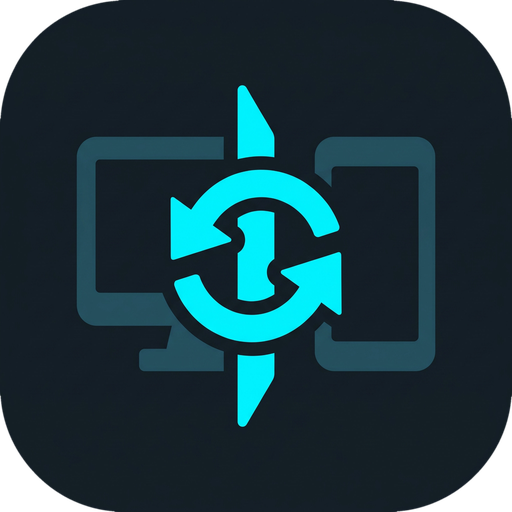

<p align="center"></p>

# SyncroUmbral

> **Tu móvil Android como llave de tu PC con Windows.** Mientras el móvil esté en tu red (o conectado por cable) la aplicación del PC
> está abierta. Si se va, la aplicación se bloquea y oculta todo lo que había en pantalla. Sin móvil, solo se abre con una clave de respaldo.
> Además trae al PC tus notificaciones, tus archivos y tus apps.

Estado: **beta 0.7.8** · PC con interfaz nativa Slint (la versión Tauri de `desktop/` queda como referencia y ya no se publica) · Parte del portafolio de **SyncroApp** · Desarrollador: SyncroApp, `syncroapp.dev@gmail.com`
(nombre anterior del proyecto: Umbral) · Seguridad: [docs/AUDITORIA_SEGURIDAD.md](docs/AUDITORIA_SEGURIDAD.md)

Novedades de cada versión: [CHANGELOG.md](CHANGELOG.md).

## Índice

1. [Qué hace](#qué-hace)
2. [Cómo funciona (en 30 segundos)](#cómo-funciona-en-30-segundos)
3. [Qué hay en este repositorio](#qué-hay-en-este-repositorio)
4. [Instalar y usar](#instalar-y-usar)
5. [Compilar y probar](#compilar-y-probar)
6. [Frente a las alternativas](#frente-a-las-alternativas)
7. [Limitaciones conocidas](#limitaciones-conocidas)
8. [Hoja de ruta](#hoja-de-ruta)
9. [Documentación](#documentación)

## Qué hace

- **Presencia y bloqueo.** El móvil envía un latido firmado cada 2 s; sin latido durante 10 s la aplicación se bloquea (pantalla borrosa,
  contenido fuera de la interfaz) y se cierran las ventanas, transferencias y apps abiertas.
- **Bloquear y desbloquear desde el móvil.** La notificación permanente de SyncroUmbral en el móvil trae los botones **Bloquear** y
  **Desbloquear**: no hace falta abrir la app. *Desbloquear* exige tener el teléfono desbloqueado (si no, quien tuviera el móvil bloqueado
  en la mano podría abrirte el PC). También están en "Acciones rápidas" de la app.
- **Residente y ligero.** Al cerrar la ventana queda en la bandeja del sistema con unos 5 MB y sigue recibiendo notificaciones.
  Se puede iniciar con Windows. Una sola copia a la vez.
- **Archivos.** Explorador de dos paneles (PC y móvil), arrastrar y soltar desde el Explorador, copia de archivos y carpetas en ambos
  sentidos con varios archivos a la vez, progreso y cancelación. Cada archivo se verifica por tamaño y nunca queda a medias.
  Renombrar, crear y eliminar en el móvil. Las listas se manejan con teclado (flechas, Espacio, Intro).
- **Interfaz cuidada.** Tipografía Inter, iconos vectoriales, menú plegable con iconos y, en pantallas grandes, un panel derecho con la batería del móvil y acciones rápidas; las páginas aprovechan todo el ancho.
- **Galería, contactos, llamadas y SMS.** Fotos y vídeos del móvil por álbum (cámara, capturas, WhatsApp, descargas...) con miniaturas, contactos con búsqueda, marcar y devolver llamadas desde el PC, y mensajes SMS (no MMS ni RCS). Permisos opcionales.
- **Portapapeles y envío rápido.** El portapapeles viaja en ambos sentidos; clic derecho en un archivo, «Enviar al móvil con SyncroUmbral».
- **Extras de seguridad y comodidad.** Copiar códigos de verificación con un clic, buscar el móvil (suena al máximo), bloquear Windows al alejarte, ocultar el contenido de los avisos, silenciar por palabras, copia automática de fotos y actualización automática.
- **Compartir con el PC.** Desde el menú Compartir de cualquier app del móvil, el texto o los archivos llegan al PC.
- **Notificaciones.** Llegan al PC en una ventana emergente y en su pestaña. Se responde desde el PC (WhatsApp, Telegram, SMS y cualquier
  app con respuesta rápida), se pulsan sus botones, se descartan o se silencia la app. Con la aplicación bloqueada no se muestra ni guarda nada.
- **Apps del móvil en el PC.** "Abrir en el PC" abre cualquier app en su propia ventana (scrcpy, pantalla virtual: el móvil puede seguir
  bloqueado y dormido). La sesión vive en el móvil, así que no hay que volver a iniciar sesión.
- **Mensajería web.** WhatsApp, Instagram, Facebook, Messenger y Telegram en sus clientes web oficiales, cada uno en su
  propia ventana de Edge, aislada y con la sesión guardada en el PC; se cierra al bloquear.
- **Llamadas.** Aviso con sonido en el PC y botones Contestar y Rechazar (llamadas normales y de WhatsApp). Opcionalmente silencia el
  resto de sonidos del PC mientras suena. El audio de la conversación sigue en el móvil.
- **Aplicaciones.** Mosaico con los iconos reales de las apps, búsqueda y acciones; abrir, detener, ajustes, extraer APK, borrar datos y desinstalar (por adb).
- **Portabilidad.** SyncroUmbral descarga por sí mismo `adb` (Google) y `scrcpy` (GitHub) en versiones fijas, con su SHA-256 incrustado y verificado.
- **Dos modos.** *Básico* (sin depuración: bloqueo, archivos, notificaciones, compartir, mensajería web) y *completo* (con depuración:
  además abrir y gestionar apps del móvil). Ver [docs/INSTALACION.md](docs/INSTALACION.md).
- **Seguridad.** TLS con huella fijada, vinculación por QR de un solo uso, clave privada del móvil no exportable (Android Keystore),
  reto-respuesta en cada conexión, secretos del PC protegidos con DPAPI, nombres de archivo saneados, entradas validadas.

## Cómo funciona (en 30 segundos)

```
 ┌──────────── MÓVIL (Android, Kotlin) ────────────┐              ┌────────── PC (Windows, Tauri + Rust) ──────────┐
 │ Servicio en primer plano (LinkService)          │     wss      │ Servidor TLS en el puerto 47600 (server.rs)    │
 │  · latido firmado cada 2 s ─────────────────────────────────────▶ · sin latidos 10 s → BLOQUEADO (core.rs)     │
 │  · notificación con Bloquear / Desbloquear      │ (huella      │ Interfaz HTML/JS en la ventana (desktop/ui)    │
 │ Notificaciones, archivos, llamadas, apps        │  fijada)     │  · archivos, notificaciones, apps, mensajería  │
 │ Clave privada en el Android Keystore            │              │ Bandeja, emergente, mDNS, DPAPI, adb, scrcpy   │
 └─────────────────────────────────────────────────┘              └────────────────────────────────────────────────┘
```

1. **Vincular (una vez):** el PC muestra un QR con su dirección, la huella de su certificado y un código de un solo uso. El móvil
   pide confirmar mostrando la misma huella corta.
2. **Cada conexión:** TLS con la huella fijada (el móvil no confía en autoridades de certificación) y reto-respuesta: el móvil firma un
   reto aleatorio con su clave del Keystore.
3. **Mientras hay latido**, el PC está abierto. **Si deja de haberlo**, se bloquea. La clave de respaldo (Argon2id) abre sin móvil.

Detalle de módulos: [docs/ARQUITECTURA.md](docs/ARQUITECTURA.md). Mensajes del canal: [docs/PROTOCOLO.md](docs/PROTOCOLO.md).

## Qué hay en este repositorio

```
desktop/
  ui/             Interfaz del PC: index.html, style.css, main.js, notif.js (tarjetas de notificación), toast.html/js (emergente)
  src-tauri/src/  Agente del PC en Rust: servidor, bloqueo, archivos, notificaciones, apps, audio, bandeja (ver ARQUITECTURA.md)
desktop-slint/    SyncroUmbral con interfaz nativa Slint (sin WebView): comparte el agente de desktop/. Ver docs/SLINT.md
android/
  app/src/main/   App del móvil en Kotlin: servicio de conexión, lector de notificaciones, archivos, llamadas, pantalla de gestión
docs/
  PROTOCOLO.md            Mensajes entre móvil y PC
  ARQUITECTURA.md         Cómo está organizado el código
  INSTALACION.md          Instalar en otro PC o móvil, firewall, Play Protect, compilar el APK de producción
  DISTRIBUCION.md         Cómo repartirla sin bloqueos de Android
  AUDITORIA_SEGURIDAD.md  Hallazgos de seguridad y su estado
  brand/                  Logo y recursos gráficos
tools/make_icons.py       Genera los iconos de las dos apps a partir del logo
CHANGELOG.md              Qué cambió en cada versión
```

## Instalar y usar

Guía completa (firewall, Play Protect, instalación por `adb`): [docs/INSTALACION.md](docs/INSTALACION.md). Resumen:

1. Descarga de la página de [**Releases**](https://github.com/JDR404/syncroumbral/releases/latest) el instalador `SyncroUmbral-x.y.z-setup.exe` (PC) y el `.apk` (móvil). El instalador es por usuario y no pide administrador: deja SyncroUmbral en «Aplicaciones instaladas», en el menú Inicio y arrancando con Windows (también existe el `.exe` suelto, sin instalar). Crea la **clave de respaldo** al abrirlo.
2. Instala `app-release.apk` en el móvil y concede: archivos, acceso a notificaciones, avisos, y (opcional) contestar llamadas y
   mostrar sobre otras apps. La pestaña **Permisos** de la app muestra qué falta.
3. En el PC: *Móviles y ajustes* → "Mostrar QR de vinculación". En el móvil: "Escanear QR del PC" y confirma que la huella coincide.
4. Para la pestaña Aplicaciones: en *Móviles y ajustes*, tarjeta Herramientas, instala adb y scrcpy y activa la depuración inalámbrica
   (o USB) en el móvil.

El firewall de Windows pedirá permitir `syncroumbral.exe` en redes privadas (puerto TCP 47600 y mDNS).

## Compilar y probar

PC (requiere Rust, Node y las Build Tools de MSVC):

```
cd desktop
npm install
npx tauri build                     # instalador: src-tauri/target/release/bundle/nsis/SyncroUmbral_0.4.0_x64-setup.exe
npx tauri build --no-bundle         # solo el ejecutable: src-tauri/target/release/syncroumbral.exe
npx tauri build --debug --no-bundle # ejecutable de depuración (más rápido de compilar)
cargo test --manifest-path src-tauri/Cargo.toml

# interfaz nativa Slint
cd ../desktop-slint
cargo build --release               # target/release/syncroumbral.exe
cargo test --release                # agente + interfaz sin ventana
```

Android (requiere JDK 17 y el Android SDK; no hace falta Android Studio):

```
cd android
.\gradlew.bat assembleRelease    # app/build/outputs/apk/release/app-release.apk (no depurable, firmado con tu clave: ver docs/INSTALACION.md)
adb install -r app\build\outputs\apk\release\app-release.apk
# Solo para desarrollo: .\gradlew.bat assembleDebug (depurable; se instala junto a la de producción como app.syncroapp.umbral.debug)
```

Notas para quien pruebe:

- Para probar el PC **sin tocar tu perfil**, arráncalo con `--data-dir=RUTA` (perfil aparte). Solo hay una copia a la vez: cierra la que tengas abierta.
- Si el firewall bloquea el ejecutable de pruebas, `adb reverse tcp:47600 tcp:47600` hace que el móvil llegue por cable (la app ya prueba `127.0.0.1`).
- Dos pruebas tocan el audio real del PC y por eso están marcadas `ignore` (`mutes_foreign_sessions_and_restores_them` y el diagnóstico `dump_sessions`).
  Si alguna vez algo quedara en silencio: `cargo test --manifest-path src-tauri/Cargo.toml repair_audio -- --ignored`.
- La compilación con `--features webdebug` es solo para pruebas (abre un puerto de depuración); no usarla para instalar.

## Frente a las alternativas

| | SyncroUmbral | Phone Link (Microsoft) | KDE Connect |
|---|---|---|---|
| Apps del móvil en ventanas del PC | Cualquier Android con depuración; el móvil puede estar bloqueado | Según Microsoft, solo dispositivos seleccionados (sobre todo Samsung) | No |
| Bloqueo del PC según presencia del móvil | Sí, firmado y con clave de respaldo | No | No |
| Notificaciones con respuesta | Sí, más silenciar apps | Sí, con filtro por app | Sí |
| Transferencias verificadas | Tamaño comprobado, sin archivos a medias | - | Una reseña critica que una transferencia grande puede darse por buena sin completarse |
| Portapapeles compartido | PC a móvil; móvil a PC con Compartir (límite de Android) | Sí | Sí |
| Llamadas, SMS | Contestar/rechazar (sin audio), sin SMS | Sí (llamadas por Bluetooth) | Notificaciones de llamadas y mensajes |
| Control remoto, multimedia | No | - | Sí (panel táctil, control multimedia) |
| Sistema | Android | Android 10 o superior; iPhone con menos funciones | Android, varios sistemas de escritorio |

Fuentes: [Microsoft Phone Link](https://support.microsoft.com/en-US/phone-link?fromAR=3), [comparativa de requisitos de Phone Link](https://www.sikich.com/insight/microsoft-phone-link-why-you-should-care-and-how-to-get-started/),
[KDE Connect en F-Droid](https://f-droid.org/en/packages/org.kde.kdeconnect_tp/), [reseña de KDE Connect](https://www.ctrl.blog/entry/review-kde-connect/),
[scrcpy v3.0](https://github.com/Genymobile/scrcpy/releases/tag/v3.0). Las comparaciones reflejan lo que se encontró en esas páginas; revisa la versión actual de cada producto.

## Limitaciones conocidas

- Versión Tauri (`desktop/`): con la ventana abierta usa unos 230 MB privados repartidos en 7 procesos (WebView2); cerrada, solo el agente en la bandeja (~7 MB privados). La versión nativa Slint (`desktop-slint/`) usa ~8 MB privados en un solo proceso con la ventana abierta y el móvil conectado (medido).
- Solo Android. En iPhone no es posible listar ni gestionar apps.
- Las llamadas se pueden contestar o rechazar desde el PC, pero **el audio no se puentea**: Windows no ofrece a las apps de terceros el papel de
  auricular Bluetooth y Android no permite capturar el audio de las llamadas normales. Sin SMS ni control remoto.
- El silenciado del resto de sonidos del PC mientras suena una llamada viene **activado por defecto** (se apaga en *Móviles y ajustes*, tarjeta
  Llamadas). No toca el sonido del sistema ni mejoradores o mezcladores de audio como FxSound o Voicemeeter (silenciarlos dejaría mudo todo el PC).
- Android no deja a una app en segundo plano leer el portapapeles: del móvil al PC se usa Compartir.
- La depuración inalámbrica de Android se apaga al cambiar de red o reiniciar el móvil; hay que volver a activarla (sin emparejar otra vez).
- Las apps con captura de pantalla bloqueada (bancos) se ven en negro en "Abrir en el PC".
- El móvil recuerda un solo PC; un PC puede tener varios móviles.
- Un servicio de accesibilidad de autoclic activo en el móvil puede confirmar solo los diálogos de SyncroUmbral (ninguna app puede impedirlo; la app avisa).

## Hoja de ruta

| Fase | Qué | Por qué |
|---|---|---|
| Hecho (0.4.0) | **Interfaz nativa con [Slint](https://slint.dev)** en lugar de WebView2 ([`desktop-slint/`](desktop-slint), ver [docs/SLINT.md](docs/SLINT.md)) | Un proceso y ~8 MB privados frente a 7 procesos y ~230 MB. Archivos, notificaciones con respuesta y controles, llamadas, apps del móvil en el PC, mensajería en una ventana aislada de Edge, vinculación por QR, bandeja e instancia única, probados con un Pixel 9 Pro. Licencia resuelta: el proyecto es GPL-3.0-or-later, compatible con Slint bajo GPLv3 |
| En espera | Firma de código de Windows (SignPath Foundation la rechazó por ahora por falta de visibilidad pública, ver [docs/FIRMA.md](docs/FIRMA.md)); el actualizador ya va firmado | Evitar SmartScreen y Play Protect y poder repartir parches (S-11 de la auditoría) |
| Después | Bluetooth LE como segundo factor de proximidad | La presencia actual es "misma red", no "cerca" (S-03) |
| Continuo | `cargo audit` y SBOM en la compilación, revisión externa | Antes de repartirla a terceros |

## Documentación

[Protocolo](docs/PROTOCOLO.md) · [Arquitectura](docs/ARQUITECTURA.md) · [Interfaz Slint](docs/SLINT.md) · [Instalación](docs/INSTALACION.md) · [Seguridad](docs/SEGURIDAD.md) ·
[Distribución](docs/DISTRIBUCION.md) · [Auditoría de seguridad](docs/AUDITORIA_SEGURIDAD.md) · [Auditoría integral y roadmap](docs/auditoria/README.md) · [Cambios](CHANGELOG.md)

## Licencia

SyncroUmbral es software libre bajo la **GNU GPL v3 o posterior** ([LICENSE](LICENSE)). Usa [Slint](https://slint.dev) bajo su licencia GPLv3, de ahí que el conjunto sea GPL.

## Política de firma de código

Página del proyecto: https://www.syncroapp.dev/syncroumbral/ · Política de privacidad: https://www.syncroapp.dev/syncroumbral/privacidad

**Estado actual:** los ejecutables de Windows todavía **no están firmados** (SmartScreen puede avisar); cada versión publica su `SHA256SUMS.txt` para verificarlos. Las versiones publicadas hasta ahora se compilaron en el equipo del autor.

**Plan:** la solicitud del certificado gratuito de [SignPath Foundation](https://signpath.org/) se envió el 2026-11-19 y el 2026-11-20 respondieron que por ahora no pueden aprobarla: el programa pide antes una visibilidad pública que el proyecto aún no tiene. Se volverá a solicitar cuando la tenga. Mientras tanto las versiones siguen sin firma de Windows y se verifican con su `SHA256SUMS.txt`. Si se consigue un certificado, las versiones se compilarán en GitHub Actions a partir de este repositorio público (`.github/workflows/build-windows.yml`, ya preparado) y este apartado se actualizará entonces.

- **Autor y aprobador de las firmas:** el propietario del repositorio ([@JDR404](https://github.com/JDR404)).
- **Privacidad:** el programa no envía datos a servidores del autor; solo habla con tu móvil por la red local y consulta las publicaciones de GitHub para buscar actualizaciones. Detalle en [docs/SEGURIDAD.md](docs/SEGURIDAD.md).
- Además, la actualización automática verifica una firma propia (ECDSA P-256) de `SHA256SUMS.txt`.
