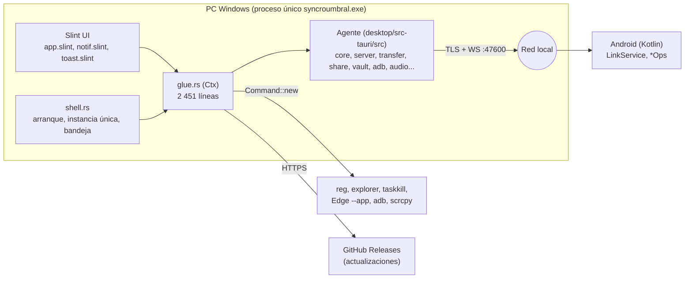

# 02 · Auditoría técnica

Formato de cada hallazgo: **Problema → Evidencia → Impacto → Causa probable → Solución → Esfuerzo** (S < 1 día, M 1–3 días, L 1–2 semanas, XL > 2 semanas). Esfuerzos para una persona que conoce el código; son estimaciones, no compromisos.

## 1. Arquitectura actual

Lo que está bien **[H]**:
- El agente no depende de la interfaz: trait `Ui` (`desktop/src-tauri/src/ui.rs`), que permitió cambiar Tauri por Slint sin reescribir el núcleo.
- Seguridad de diseño: certificado fijado, límites antes de autenticar, sellos HMAC, DPAPI, actualizaciones con firma propia (ver docs/AUDITORIA_SEGURIDAD.md, mayoría de hallazgos corregidos).
- Consumo muy bajo (ver 03, sección rendimiento).
- Configuración y rutas sin valores absolutos de usuario: carpetas desde `APPDATA`/`LOCALAPPDATA`/known folders.

## 2. Hallazgos de arquitectura y código

### A-01 · El agente vive dentro de la carpeta de una versión retirada
- **Evidencia**: `desktop-slint/src/main.rs:6-41` incluye 18 módulos con `#[path = "../../desktop/src-tauri/src/…"]`.
- **Impacto**: acoplamiento por rutas; cualquier cambio en `desktop/` afecta al producto real; confunde a quien llega; `cfg(feature = "slint-ui")` repartido por el agente.
- **Causa**: migración incremental Tauri → Slint (2026-11-18/19) sin cerrar la reorganización.
- **Solución**: crear un *workspace* Cargo con `crates/umbral-core` (biblioteca: el agente) y `desktop-slint` (binario). Mover archivos con `git mv` (conserva historial). Archivar o borrar `desktop/` tras confirmar que nada lo usa.
- **Esfuerzo**: M.

### A-02 · `glue.rs` concentra demasiado (objeto dios)
- **Evidencia**: 2 451 líneas, 105 funciones, un único `Ctx` con estado de archivos, galería, mensajería, actualizaciones, herramientas, ajustes, menú contextual y presencia.
- **Impacto**: difícil de probar y revisar; cada cambio de interfaz toca el mismo archivo; riesgo de regresión alto.
- **Solución**: dividir por dominio en submódulos (`glue/files.rs`, `glue/gallery.rs`, `glue/messaging.rs`, `glue/update.rs`, `glue/settings.rs`…) sin cambiar comportamiento. Empezar por `update.rs` (aislable y con defectos conocidos).
- **Esfuerzo**: M (por partes).

### A-03 · Código de sistema operativo disperso y sin contrato
- **Evidencia**: 21 bloques `cfg(windows)` en 10 archivos; `Command::new("reg"|"explorer"|"taskkill"|"rundll32")`; `LockWorkStation` dentro de la lógica de presencia (`glue.rs:1808`); DPAPI en `vault.rs:37`; en otros sistemas `dpapi()` devuelve el dato **sin cifrar** (`vault.rs:62-65`).
- **Impacto**: portar a Linux/macOS obliga a tocar lógica de negocio; el respaldo «sin cifrar» compila en otros sistemas y podría llegar a producción por error.
- **Solución**: módulo `platform` con trait (`Platform`: `protect/unprotect`, `lock_session`, `autostart`, `known_folders`, `context_menu`, `open_url`, `mark_downloaded`, `mute_others`, `work_area`) e implementaciones `windows.rs`, `linux.rs`, `macos.rs`; en sistemas sin implementación, error de compilación o función desactivada explícitamente, nunca un *fallback* inseguro.
- **Esfuerzo**: L.

### A-04 · Errores silenciados y `unwrap` en caminos de ejecución
- **Evidencia**: 197 `unwrap()` fuera de pruebas (146 son `lock().unwrap()`), 133 `let _ =` que descartan resultados (p. ej. escrituras de registro, `spawn` de procesos).
- **Impacto**: un *mutex* envenenado por un pánico tumba la app entera; fallos de E/S quedan sin rastro (el caso del arranque solo se pudo diagnosticar tras añadir `startup.log`).
- **Solución**: registro general de errores (ver 08, mejora F-03) y revisar los `let _ =` de operaciones con efecto (registro, archivos, procesos): registrar el error. Para `lock().unwrap()`, aceptable con `panic = abort` documentado o usar `parking_lot`.
- **Esfuerzo**: M.

### A-05 · Puertos fijos
- **Evidencia**: `core.rs:17` `PORT = 47600`; `shell.rs:12` `SINGLE_PORT = 47601`.
- **Impacto**: si otro programa los ocupa, la app no sirve o arranca sin protección de instancia única (lo registra desde 0.7.1).
- **Solución**: instancia única por *named mutex*/pipe con nombre del usuario (Windows) o socket en `XDG_RUNTIME_DIR` (Linux); servidor: si 47600 está ocupado, puerto alternativo anunciado por mDNS y en el QR.
- **Esfuerzo**: M.

### A-06 · Datos huérfanos y sin límite
- **Evidencia [H]**: `%APPDATA%\app.syncroapp.umbral\web` = **1 027 MB** (perfiles WebView2 de la versión Tauri, que la versión Slint no usa); `web-edge` = **1 035 MB** (WhatsApp 694 MB).
- **Impacto**: 2 GB en el perfil del usuario; el desinstalador ofrece borrarlos pero nadie los limpia antes.
- **Solución**: migración única que borre `web` si existe `web-edge` (o lo ofrezca); en Ajustes, tamaño de cada sesión y «Vaciar caché».
- **Esfuerzo**: S.

### A-07 · Documentación desalineada con el código
- **Evidencia**: `SLINT.md` dice que «las 43 pruebas del agente corren con Tauri» (no se ejecutan en ningún flujo actual, ver H-02); `FUNCIONES.md` P15 dice que la huella «no protege de una publicación comprometida» (ya hay firma ECDSA desde 0.6.0); `AUDITORIA_SEGURIDAD.md` S-11 sigue «Pendiente» y sin actualizador.
- **Impacto**: decisiones sobre información falsa.
- **Solución**: corregir esos tres textos en la próxima entrega; regla: el CHANGELOG y FUNCIONES se tocan en el mismo commit que el código.
- **Esfuerzo**: S.

### A-08 · Commits grandes y sin revisión
- **Evidencia**: `feat: 0.4.0 - galeria, contactos, llamadas, SMS, portapapeles, envio rapido, 2FA, buscar movil, ajustes...` en un solo commit; 45 commits en total; sin PR salvo uno.
- **Impacto**: imposible bisecar regresiones ni revertir una función aislada.
- **Solución**: un commit por cambio lógico; ramas y PR para cambios de producto aunque el revisor sea uno mismo (la CI corre en el PR).
- **Esfuerzo**: hábito.

## 3. Calidad del ciclo de vida (proceso)

- Arranque: `shell.rs run()` → `startlog` → instancia única (reintenta 6 s) → carpeta de datos y migraciones → `repair_autostart` → `boot::init` (reintenta 8×3 s) → tokio (2 hilos) → ventana (reintenta) → bandeja → bucle Slint. Bien instrumentado desde 0.7.1/0.7.2.
- Cierre: cerrar la ventana la oculta; «Salir» de la bandeja termina; al cerrar se cierran las ventanas de Edge (`edge_close_all`). Procesos `scrcpy` por app en `appwin.rs` [I]: no se verificó que se cierren todos al salir (ver 07, caso CV-09).
- Hilos medidos: 9 en reposo [H].
