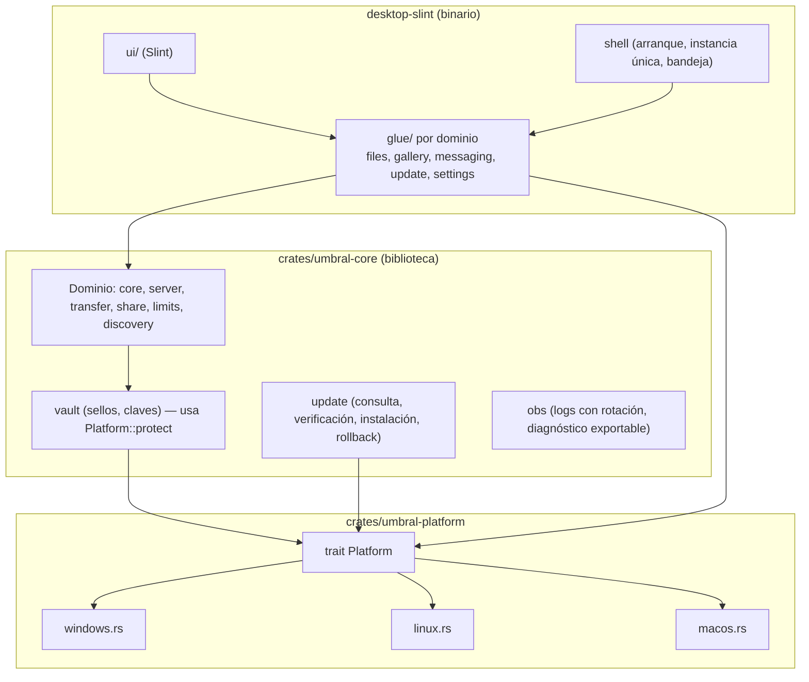

# 05 · Arquitectura objetivo

**Decisión**: refactorización incremental, sin reescritura. El núcleo ya está separado de la interfaz (trait `Ui`); falta separarlo también del sistema operativo y sacarlo de la carpeta de la versión Tauri. Slint, tokio, rustls y el protocolo se mantienen: son portables y el consumo medido (13 MB privados, 0,05 % CPU) es excelente.

## Componentes



## Contratos

```rust
pub trait Platform: Send + Sync {
    // Seguridad
    fn protect(&self, data: &[u8]) -> Result<Vec<u8>>;      // DPAPI / Secret Service / Keychain
    fn unprotect(&self, data: &[u8]) -> Result<Vec<u8>>;
    // Ciclo de vida
    fn autostart_status(&self) -> AutostartStatus;           // Activo, DesactivadoPorSistema, OtraCopia, Ausente
    fn set_autostart(&self, on: bool) -> Result<()>;
    fn single_instance(&self) -> Result<InstanceGuard>;      // mutex con nombre / socket en XDG_RUNTIME_DIR
    // Integración
    fn lock_session(&self) -> Capability<()>;                // Capability::Unsupported donde no exista
    fn known_folders(&self) -> Folders;
    fn context_menu(&self, on: bool) -> Capability<()>;
    fn open(&self, target: &OpenTarget) -> Result<()>;       // URL o carpeta
    fn mark_downloaded(&self, path: &Path);                  // Zone.Identifier / quarantine / nada
    fn mute_others(&self) -> Capability<MuteGuard>;
    fn work_area(&self) -> Option<Rect>;
    fn chromium_app_window(&self) -> Option<PathBuf>;        // Edge / Chrome / Chromium
}
```

`Capability::Unsupported` hace que la interfaz oculte la opción, en vez de fingir que funciona.

## Estrategia de migración (cada paso compila, pasa pruebas y se publica)

1. **Pruebas primero**: mover las pruebas del servidor a un arnés sin Tauri (H-02). Sin esto, los pasos siguientes no tienen red de seguridad.
2. **Workspace y mudanza**: `crates/umbral-core` con `git mv` desde `desktop/src-tauri/src`; `desktop-slint` depende de él. Borrar `#[path]`. Retirar `desktop/` (o moverlo a una rama `tauri-archivo`).
3. **Capa de plataforma**: crear `umbral-platform` con la implementación Windows extrayendo el código existente tal cual; el comportamiento en Windows no cambia (criterio de aceptación: mismas pruebas y prueba manual de 07).
4. **Dividir `glue.rs`** por dominio, empezando por `update`.
5. **Linux**: `linux.rs` + AppImage + CI con `ubuntu-latest`.
6. **macOS**: `macos.rs` + firma/notarización cuando haya cuenta de desarrollador.

## Justificación

| Decisión | Por qué | Alternativa descartada |
|---|---|---|
| Mantener Slint | Portable, nativo, 13 MB; ya funciona | Volver a Tauri/WebView: 7 procesos y ~230 MB medidos (SLINT.md) |
| Trait de plataforma con implementaciones por `cfg` | Cero coste en ejecución; el compilador obliga a cubrir cada sistema | Comprobaciones en tiempo de ejecución dispersas |
| AppImage antes que Flatpak | adb/scrcpy/red local sin *sandbox* | Flatpak: permisos y portales complican lanzar procesos |
| Mantener el actualizador propio | Ya verifica firma propia; funciona en los tres sistemas con un asset por sistema | Frameworks de actualización de terceros: más dependencias |
