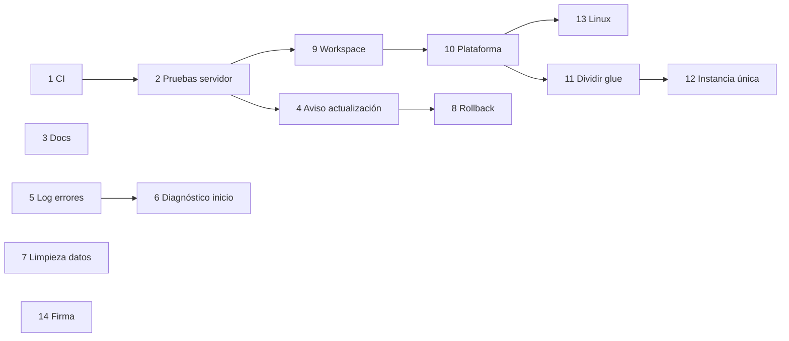

# 09 · Plan de implementación

Backlog ordenado. Cada tarea es un PR independiente que compila, pasa la CI y no cambia el comportamiento salvo donde se indica.

| # | Tarea | Archivos | Riesgo de regresión | Validación | Rollback |
|---|---|---|---|---|---|
| 1 | CI en push/PR: fmt, clippy, test, audit, Gradle | `.github/workflows/ci.yml` (nuevo) | Nulo | La CI corre en un PR de prueba | Borrar el archivo |
| 2 | Arnés de pruebas del servidor sin Tauri (H-02) | `desktop/src-tauri/src/server.rs:297-300`, `server_tests.rs`, nueva `Ui` falsa | Nulo en producción | `cargo test` en desktop-slint lista `server::tests` | Revertir PR |
| 3 | Corregir docs desalineadas (A-07) | `docs/SLINT.md`, `docs/FUNCIONES.md` (P15), `docs/AUDITORIA_SEGURIDAD.md` (S-11) | Nulo | Lectura | — |
| 4 | Aviso tras actualizar (F-01, H-01) | `glue.rs do_update`, `shell.rs` (argumento `--updated-from`), `app.slint` | Bajo | CV-07 con una publicación de prueba | Revertir; el actualizador viejo sigue funcionando |
| 5 | Registro general de errores (F-03) | `shell.rs startlog` → módulo `obs`; puntos con `let _ =` en `glue.rs`, `autostart.rs` | Bajo | Forzar errores en pruebas; ver líneas en el log | Revertir |
| 6 | Diagnóstico del inicio en Ajustes (F-04, H-06) | `autostart.rs` (`autostart_status` leyendo también `StartupApproved`), `app.slint` | Bajo | Desactivar en Windows → la app lo muestra | Revertir |
| 7 | Limpieza de `web` huérfano y tamaño de sesiones (F-06) | `boot.rs` (migración), `glue.rs` mensajería | Medio (borra datos) | Solo borrar `web` si existe `web-edge` y tras confirmación | Desactivar la migración |
| 8 | Rollback del actualizador (F-02, H-05) | `glue.rs` (pasar a `update.rs`), `shell.rs` (marca `update-ok`) | Medio | CV-08 con publicación rota de prueba | Revertir; queda el comportamiento actual |
| 9 | Workspace y `crates/umbral-core` (A-01) | `Cargo.toml` raíz nuevo, `git mv desktop/src-tauri/src/* crates/umbral-core/src/`, `desktop-slint/src/main.rs` | Medio | Toda la batería + CV-01/02 | Revertir el PR (movimiento puro) |
| 10 | `umbral-platform` con Windows (A-03) | Nuevo crate; extraer de `vault.rs`, `autostart.rs`, `places.rs`, `audio.rs`, `glue.rs:1101,1808,1016`, `context_menu` | Medio | Cero `cfg(windows)` fuera del crate; batería completa | Revertir |
| 11 | Dividir `glue.rs` (A-02) | `desktop-slint/src/glue/*.rs` | Bajo-medio | Batería + capturas `selftest` | Revertir |
| 12 | Instancia única sin puerto (A-05) | `shell.rs` → `Platform::single_instance` | Medio | CV-06, CV-13 | Revertir |
| 13 | `linux.rs` + AppImage + CI Ubuntu (E3) | `umbral-platform/src/linux.rs`, `instalador/linux/`, workflow | Nulo en Windows | Casos E3 en Ubuntu y Fedora reales | No publicar la AppImage |
| 14 | Firma de código Windows (H-03) | Workflow (paso de firma) | Nulo | Propiedades del exe muestran firma; SmartScreen | Publicar sin firmar como hoy |

## Secuencia y dependencias

Las tareas 3, 5, 7 y 14 no bloquean ni dependen del camino crítico y pueden intercalarse.

## Estrategia de validación general

- Antes de cada PR: `cargo test --release`, capturas `selftest` de las pantallas tocadas.
- Antes de cada publicación: criterios de salida de 07.
- Mover código (9, 10, 11) sin reescribirlo en el mismo PR: primero mover, luego mejorar.
